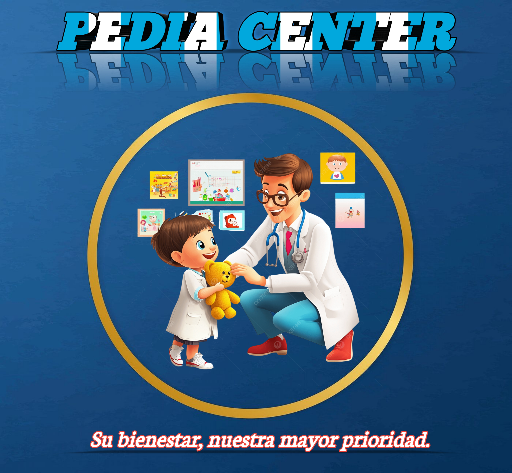

PediaCenter Clínica Pediátrica

PROYECTO FINAL

"Java" (https://img.shields.io/badge/java-%23ED8B00.svg?style=for-the-badge&logo=openjdk&logoColor=white)

🖥️ DEVS

HUGO, DIEGO, PABLO, JEYLY Y ANDREA

  

🩺 Descripción

PediaCenter es una aplicación de escritorio desarrollada en Java para organizar la información de una clínica pediátrica. Permite registrar pacientes, administrar citas y consultar el historial de sus consultas y controles.

📋 Problemática

Guardar la información en diferentes archivos dificulta encontrar los datos y dar seguimiento a los pacientes. El proyecto busca reunir los registros en una misma base de datos para facilitar su consulta y actualización.

⚙️ ¿Cómo funciona?

El sistema cuenta con dos tipos de usuario:

Secretaria: registra pacientes y organiza las citas.

Médico: administra la información clínica, registra consultas y exámenes, revisa el crecimiento y crea cuentas de usuario.

Sus principales funciones son:

📁 Registrar pacientes.

📁 Buscar pacientes.

📁 Modificar información.

📁 Eliminar registros.

📁 Consultar el historial clínico.

📁 Programar y actualizar citas.

📁 Registrar peso y talla.

📁 Consultar gráficas de crecimiento.

📁 Guardar exámenes y archivos adjuntos.

📁 Exportar expedientes a PDF.

📊 Objetivo

Desarrollar una aplicación que ayude al médico y a la secretaria a organizar los datos de los pacientes y las actividades de la clínica.

🛠️ Herramientas utilizadas

Java y Swing

MySQL

NetBeans

Maven

GitHub

📂 Estructura del sistema

ui: ventanas, formularios e imagen.

modelo: definición de campos y módulos.

dao: conexión a MySQL.

servicio: operaciones con los datos, usuarios y generación de PDF.

▶️ Ejecución

Abre el proyecto en NetBeans, importa el script de la carpeta "database" en MySQL y configura tu conexión en "config.properties". Después, ejecuta el proyecto.
